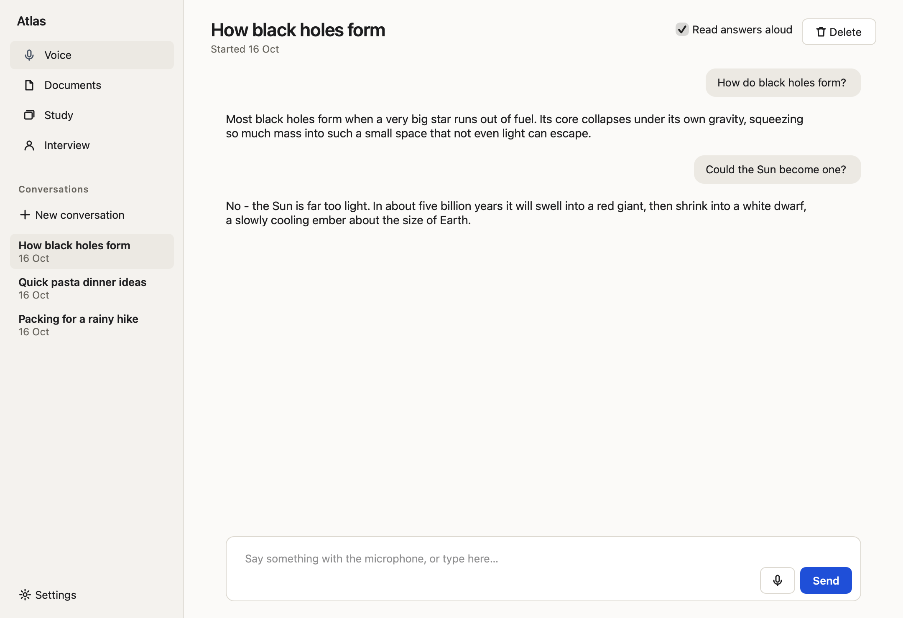
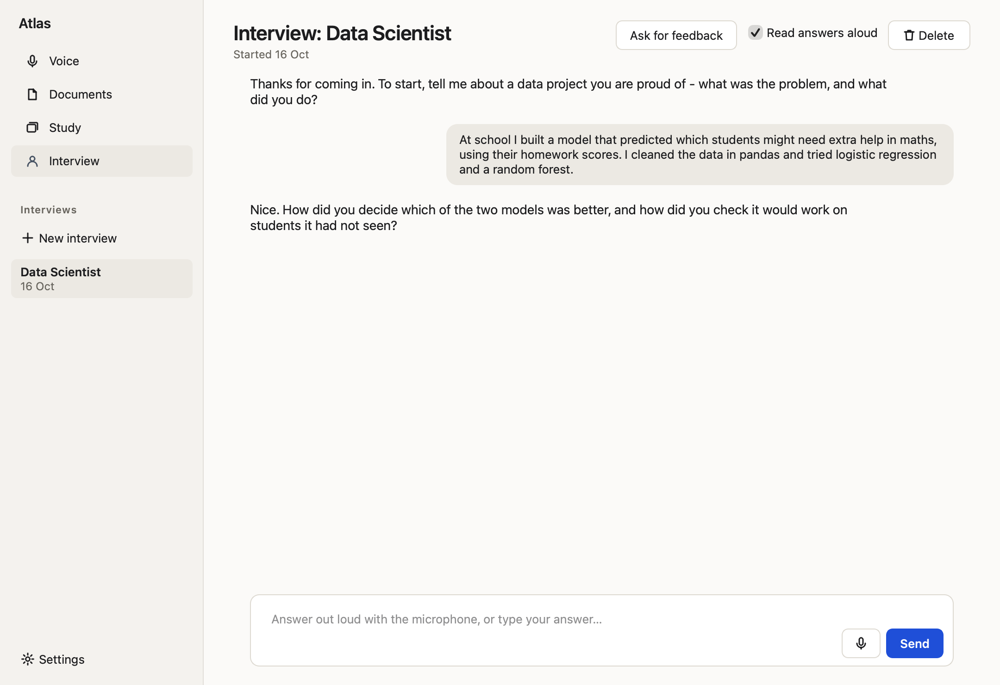

# Atlas

> **One app. Four ways to think faster.**
> Voice chat, document chat, AI flashcards and interview practice — together on your desktop.

Atlas is a desktop AI app with four modes that share one window, one database and one design: talk to it,
chat with a PDF, turn notes into flashcards, or practise a job interview out loud.




%20%C2%B7%20Groq%20%C2%B7%20Whisper%20%C2%B7%20SQLite-blueviolet)

## What's inside

| Mode          | What it does                                                                |
|---------------|-----------------------------------------------------------------------------|
| **Voice**     | Click the mic, speak, hear the answer. Whisper (on Groq) turns speech into text, Llama 3.3 replies, the system voice reads it aloud. Typing works too. |
| **Documents** | Add a PDF (drop it on the window), then chat with it. Answers come only from the document. |
| **Study**     | Paste notes. The AI makes 8–15 flashcards; review them with Space and the arrow keys. Decks are kept. |
| **Interview** | Pick a role. Atlas plays the hiring manager — one question at a time, follow-ups, honest feedback. Answer by voice or text. |

Every conversation, document and deck is kept in the sidebar of its mode.



## Getting started

### 1. Get a free Groq API key
Sign up at [console.groq.com/keys](https://console.groq.com/keys). That one key is all Atlas needs — the
answers (Llama 3.3) and speech to text (Whisper) both run on Groq.

### 2. Start the app

**macOS:** double-click `start.command`. The first start installs what the app needs (a minute or two),
after that it opens straight away.

**Windows / Linux:**

```bash
python -m venv .venv
.venv\Scripts\activate          # Windows
source .venv/bin/activate       # Linux
pip install -r requirements.txt
python app.py
```

### 3. Add your key
The app asks for it the first time you use it (or open **Settings**). The key is checked with Groq, then saved
in the system keychain. You can also put it in a `.env` file (see `.env.example`) or the `GROQ_API_KEY`
environment variable.

> **Microphone:** the first time you click the mic, your system asks whether the app may use the microphone.
> On macOS you can change this later in System Settings → Privacy & Security → Microphone.

## Architecture

```
                 ┌──────────────────────────────┐
                 │   Atlas window (Qt)          │
                 │   microphone  → sounddevice  │
                 │   read aloud  → system voice │
                 └──────┬──────────────▲────────┘
          speech / text │              │ reply
                        ▼              │
                 ┌──────────────────────────────┐
                 │  background jobs (threads)   │   the window never freezes
                 └──┬─────────────────────┬─────┘
                    ▼                     ▼
             ┌────────────┐        ┌────────────┐
             │  Whisper   │        │   Llama    │
             │  (Groq)    │        │ 3.3 (Groq) │
             └────────────┘        └────────────┘
                    │
                    ▼
             ┌─────────────┐
             │  SQLite     │  conversations · messages
             │  atlas.db   │  documents · decks · flashcards
             └─────────────┘
```

### Database schema

- **conversations** — `id`, `mode` (voice/doc/interview), `title`, `document_id?`, `role_name?`, timestamps
- **messages** — `id`, `conversation_id`, `role`, `content`, `created_at`
- **documents** — `id`, `title`, `filename`, `text_content`, `page_count`, `char_count`
- **decks** + **flashcards** — for Study mode

Everything is foreign-keyed with `ON DELETE CASCADE`: deleting a document removes its chats, deleting a deck
removes its cards.

### Document chat without a vector database

Short documents (up to about 14,000 characters) are sent whole. For longer ones Atlas splits the text into
passages, scores them against your question (and your last message) with BM25 keyword ranking, and sends the
best ones plus the document's opening — so long PDFs stay inside the free Groq limits without any extra
libraries. (For embedding-based retrieval with ChromaDB, see my separate project RagChat.)

## Project layout

```
Atlas/
├── app.py                Starts the app
├── start.command         Double-click launcher for macOS (sets itself up on first run)
├── atlas/
│   ├── ai.py             Prompts, titles, flashcards, passage ranking, PDF reading
│   ├── audio.py          Microphone recording and reading aloud
│   ├── chatview.py       The chat shared by Voice, Documents and Interview
│   ├── db.py             SQLite schema and queries
│   ├── window.py         The window and the four modes
│   └── core/             Shared pieces: look, background jobs, storage, Groq client, widgets
├── tests/                Automated tests (fake AI, microphone and speaker - no key, internet or sound)
└── docs/                 Screenshots
```

Everything is saved in `~/Library/Application Support/Atlas` (macOS), `%APPDATA%\Atlas` (Windows) or
`~/.local/share/Atlas` (Linux).

## Tests

```bash
pip install pytest
python -m pytest
```

## Roadmap

- **Streaming replies** so the answer appears word by word
- **Hands-free voice** — stop recording automatically when you stop talking
- **Spaced repetition** for Study mode — surface cards on a forgetting curve
- **Resume upload** in Interview mode so the AI can ask you about *your* projects
- **Export decks** to Anki / CSV

## License

MIT — built by Martin Genov. Use it, fork it, ship it.
